# Roadmap

## 1. Principios

- Cada fase es una **porción vertical**: backend, frontend, base de datos y documentación.
- Al terminar una fase, la aplicación debe compilar, pasar los tests y ser utilizable.
- No se empieza una fase sin tener claros sus requisitos y su modelo de datos.
- Las fases pueden ajustarse, pero los cambios se registran en el [[Diario de cambios]] y, si afectan a una decisión, en un ADR.
- Cada fase tendrá su propia nota cuando empiece, usando [[Plantilla - Fase]].
- Las fases con varios entregables demostrables se dividen en sub-fases `N.M`, con criterio de aceptación propio. La regla de numeración está en [[Convenciones]].

## 2. Vista general

| Fase | Nombre                                 | Objetivo                                                                                       | Sub-fases | Estado                 |
| ---- | -------------------------------------- | ---------------------------------------------------------------------------------------------- | --------- | ---------------------- |
| 0    | Definición y documentación             | Cerrar alcance, roles, dominio, arquitectura y sistema documental.                             | —         | ✅ Cerrada (2026-11-10) |
| 1    | Entorno y esqueleto                    | Repositorio, Spring Boot, Angular, MySQL, Flyway, health check y pipeline de CI.               | 5         | ⬜ Pendiente            |
| 2    | Autenticación y seguridad base         | Login JWT, refresh, guards, layout y errores.                                                  | 6         | ⬜ Pendiente            |
| 3    | Usuarios, municipios y centros         | CRUD administrativo de usuarios, municipios y centros.                                         | 5         | ⬜ Pendiente            |
| 4    | Asignaturas y profesorado              | CRUD de asignaturas y asignación de profesores.                                                | —         | ⬜ Pendiente            |
| 5    | Alumnos, matrículas y calificaciones   | Ficha de alumno, catálogo de instrumentos, matrículas, evaluaciones y cuaderno de notas.       | 4         | ⬜ Pendiente            |
| 6    | Horarios y solicitudes                 | Rejilla semanal, validación de conflictos, copia al curso siguiente y flujo de solicitudes.    | 6         | ⬜ Pendiente            |
| 7    | Panel del profesor                     | Dashboard, mis asignaturas, mis alumnos y mi horario.                                          | —         | ⬜ Pendiente            |
| 8    | Observaciones, asistencia y calendario | Seguimiento del alumno, lista masiva por sesión y días no lectivos.                            | 4         | ⬜ Pendiente            |
| 9    | Preparación de clases                  | Planificación docente con estados y consulta admin.                                            | —         | ⬜ Pendiente            |
| 10   | Calidad, pruebas y despliegue          | Seguridad, tests, accesibilidad, documentación y Docker.                                       | 3         | ⬜ Pendiente            |
| 11   | Panel de plataforma                    | Crear, suspender y reactivar mancomunidades; métricas básicas, auditoría y soporte de cuentas. | 4         | ⬜ Pendiente            |
| 12   | Control horario                        | Fichaje de entrada y salida, panel de administración y correcciones auditadas.                 | 3         | ⬜ Pendiente            |
| 13   | PWA y modo sin conexión                | Instalación desde enlace, cacheado y cola local de fichajes.                                   | 3         | ⬜ Pendiente            |

```mermaid
flowchart LR
    F0[0. Definición] --> F1[1. Entorno]
    F1 --> F2[2. Autenticación]
    F2 --> F3[3. Usuarios, municipios y centros]
    F3 --> F4[4. Asignaturas]
    F4 --> F5[5. Alumnos]
    F5 --> F6[6. Horarios]
    F6 --> F7[7. Panel profesor]
    F7 --> F8[8. Observaciones y asistencia]
    F8 --> F9[9. Preparaciones]
    F9 --> F10[10. Calidad y despliegue]
    F10 --> F11[11. Panel de plataforma]
    F11 --> F12[12. Control horario]
    F12 --> F13[13. PWA y offline]
```

## 3. Hitos de uso

> [!info] Para qué sirve
> Indica en qué punto el producto deja de ser una demostración técnica y pasa a aportar valor real. No cambia el orden de construcción: cada fase sigue entregando una porción vertical desplegable y demostrable.

| Fase | Qué se puede hacer ya | ¿Uso real? |
| --- | --- | --- |
| 1 | Arrancar el entorno, ver la home y el health check. | No; solo verificación técnica. |
| 2 | Entrar con login, cambiar de mancomunidad y ver el layout por rol. | No; solo pruebas internas. |
| 3 | Dar de alta usuarios, municipios, centros y cursos escolares. | Empieza la carga de datos reales de administración. |
| 4 | Crear asignaturas y asignar profesorado. | El profesor ya ve «mis asignaturas». |
| 5 | Alumnos, instrumentos, matrículas, evaluaciones y calificaciones. | La administración completa el censo y el profesorado ya puede calificar. |
| 6 | Horarios, conflicto de alumno, solicitudes y copia al curso siguiente. | Primer uso útil real: sustituye la hoja de cálculo del horario. |
| 7 | Panel del profesor: dashboard, mi horario y mis alumnos. | El profesor trabaja con su información. |
| 8 | Observaciones, asistencia, calendario, ausencias y sustituciones. | Uso diario completo: sustituye el papel y el registro manual. |
| 9 | Preparación de clases. | Complemento de planificación docente. |
| 10 | Seguridad, tests, Docker de producción, copias y purga. | Listo para producción. |
| 11 | Panel de plataforma: alta y suspensión de mancomunidades. | Creación de nuevos tenants sin tocar la base de datos. |
| 12–13 | Control horario y PWA. | Fuera de la v1. |

**Lectura práctica**

- **Primer piloto con una mancomunidad:** a partir de la **Fase 6**, cargando antes los datos con las fases 3–5. Ya se pueden montar y validar horarios y registrar las primeras notas.
- **Uso diario real de profesorado y administración:** a partir de la **Fase 8**, con asistencia, calendario y ausencias.
- **Producción seria:** **Fase 10**, con tests, copias, Docker y revisión de seguridad.
- **Varias mancomunidades reales:** **Fase 11**, porque hasta entonces el alta de tenants se hace con seed u operación.
- Antes de la Fase 10 se puede pilotar, pero con datos controlados y sin prometer disponibilidad ni copias de producción.

### 3.1. Cómo se comprueba cada hito

Cada hito es una **puerta de salida** de su fase: no se declara alcanzado por haber terminado el código, sino por haber pasado una comprobación repetible sobre el seed de dos mancomunidades de [[Plan de pruebas manuales y datos de demo]].

| Hito | Cómo se comprueba | Evidencia |
| --- | --- | --- |
| Datos de administración (Fase 3) | Con la interfaz, el administrador crea un municipio, un centro adscrito a él, un profesor y un curso; después entra como usuario de la mancomunidad A e intenta leer un recurso de B cambiando el ID. | Checklist manual firmada y test de integración de aislamiento en verde. |
| Calificaciones (Fase 5) | Un alumno se matricula en una asignatura numérica y otra alfanumérica; el profesor registra una nota en cada una y la administración las ve en la ficha sin poder editarlas; otro profesor intenta calificar una asignatura que no imparte y recibe `403` o `404`; una nota duplicada responde `409`. | Checklist del cuaderno de notas, tests de escalas, opciones, evaluaciones y aislamiento en verde. |
| Horarios (Fase 6) | Un profesor monta la semana por partes, cierra sesión y la retoma; finaliza sin solapamientos; el administrador monta y finaliza el horario de otro profesor; una solicitud aprobada actualiza el horario y la copia al curso siguiente crea un borrador sin sesiones. | Checklist del flujo completo, `./mvnw verify` y `npm test` en verde. |
| Uso diario (Fase 8) | Se pasa lista de 20 alumnos cronometrando menos de 2 minutos; una corrección aparece en el historial solo para administración; un rango de vacaciones no genera sesiones y cancela las pendientes; una ausencia se aprueba y muestra `sesionesAfectadas`; una sustitución reasigna las sesiones del periodo. | Checklist cronometrada, tests de sesiones/asistencia y acta en la nota de fase. |
| Producción (Fase 10) | Se levanta el entorno desde cero con `docker compose up -d`; se restaura una copia en staging; se recorre la aplicación solo con teclado y en móvil; se revisan permisos, dependencias y migraciones Flyway. | Pipeline de CI en verde, registro de restauración y checklist de accesibilidad y seguridad. |
| Varias mancomunidades (Fase 11) | El `SUPERADMIN` crea una mancomunidad nueva, su primer administrador entra y opera; se suspende esa mancomunidad y se comprueba que el login y el refresh fallan solo en ella. | Checklist del panel de plataforma y tests de aislamiento y suspensión. |

**Método común**

1. **Partir del seed determinista** de dos mancomunidades, con datos de A y B, incluido un profesor compartido.
2. **Derivar el checklist del criterio de aceptación** de la fase y de los casos de [[Plan de pruebas manuales y datos de demo]]; no se inventan casos nuevos sin añadirlos allí.
3. **Automatizar lo repetible:** unitarios y integración con Testcontainers, `./mvnw verify`, `npm test`, `npm run lint` y `npm run build`; las pruebas E2E con Playwright son opcionales y se valoran en la Fase 10.
4. **Probar siempre el aislamiento:** un usuario de A no lee ni escribe datos de B cambiando un ID, también en los hitos de administración y de plataforma.
5. **Repetir los hitos anteriores** después de cada fase para detectar regresiones; el checklist crece, no se reemplaza.
6. **Registrar el resultado** en la nota de la fase y en el [[Diario de cambios]]: qué se probó, con qué datos, qué falló y qué quedó pendiente.

El arranque local, los puertos, las cuentas de demo y el acceso a MySQL, Mailpit, Swagger y los logs están en [[Arquitectura general]] §7.3. En staging y producción no se accede directamente a la base de datos: los diagnósticos se canalizan por operación y observabilidad.

> [!warning] Regla de corte
> Un hito no se da por alcanzado si falla el checklist, el pipeline no está en verde o no se ha probado el aislamiento entre mancomunidades. Un piloto con datos reales exige además la Fase 10 completada.

## 4. Detalle de fases

### Fase 0 — Definición y documentación ✅

- Visión, alcance y fuera de alcance.
- Roles, requisitos funcionales y no funcionales.
- Modelo de dominio y notas de entidad.
- Stack, arquitectura, seguridad y ADRs.
- Roadmap, convenciones y sistema documental.

**Entregable:** [[Fase 0 - Definición y documentación]].

### Fase 1 — Entorno y esqueleto

> [!info] En curso desde 2026-11-10
> Se avanza sub-fase a sub-fase; el detalle y el resultado viven en [[Fase 1 - Entorno y esqueleto]]. Las sub-fases 1.1, 1.2 y 1.3 están cerradas; la siguiente es la 1.4.

- Crear `backend/` con Spring Initializr (Maven, Java 21, Web, JPA, Security, Validation, Flyway, MySQL, Actuator).
- Crear `frontend/` con Angular 22 (SCSS, routing, standalone).
- `compose.yaml` con MySQL 8.4 y volumen persistente.
- Configurar perfiles `dev` y `test`; `.env.example`.
- Flyway con la migración inicial: `mancomunidad`, `usuario`, `usuario_mancomunidad`, `refresh_token`, `verificacion_email`, `evento_seguridad`, `limite_peticion`, `idempotencia`, `curso_escolar` y el resto del esquema base, con `version` en las tablas editables.
- Sembrar una mancomunidad de desarrollo de tipo `MUSICA`, su curso `2026-2027` activo y un administrador de prueba.
- `TenantContext` y filtro base de aislamiento, aunque el login completo llegue en la Fase 2.
- Endpoint `/actuator/health` y pantalla inicial de Angular.
- Proxy de Angular hacia `/api`, que incluye la API bajo `/api/v1`.
- README con arranque en tres comandos.
- Sin importación de datos existentes en la v1; si un centro llega con datos, se carga con el script de operación filtrado por `mancomunidad_id`.
- Pipeline de GitHub Actions con build, tests, lint y validación de migraciones para `main` y publicación de imágenes por etiqueta.

**Sub-fases**

| Sub-fase | Contenido                                                                                                                                 | Criterio de aceptación                                                                         |
| -------- | ----------------------------------------------------------------------------------------------------------------------------------------- | ---------------------------------------------------------------------------------------------- |
| 1.1      | Esqueleto de backend con Spring Initializr (Web, Actuator), perfiles `dev` y `test` y `/actuator/health`.                                 | `./mvnw spring-boot:run` arranca y `/actuator/health` devuelve `UP` sin base de datos.         |
| 1.2      | `compose.yaml` con MySQL 8.4, Flyway, esquema base y seed de mancomunidad de tipo `MUSICA`, curso `2026-2027` y administrador.            | `docker compose up -d` levanta MySQL y Flyway aplica las migraciones sin errores.              |
| 1.3      | `TenantContext`, resolución de la mancomunidad activa, filtro base de aislamiento y seed de `demo-b` con un profesor compartido.          | Con dos mancomunidades sembradas, una consulta sin tenant activo no devuelve datos.            |
| 1.4      | Angular 22 con proxy a `/api` (la API vive en `/api/v1`), home que consume el health y README de arranque.                                | `npm start` sirve la home, muestra el estado del backend y el README arranca en tres comandos. |
| 1.5      | Pipeline de GitHub Actions: build y tests de backend y frontend, lint, validación de migraciones Flyway y publicación de imágenes Docker. | Un PR a `main` ejecuta el pipeline en verde y bloquea el merge si falla.                       |

**Criterio de aceptación:** `docker compose up -d`, `./mvnw spring-boot:run` y `npm start` funcionan; la home carga, el health devuelve `UP` y existe una mancomunidad sembrada.

### Fase 2 — Autenticación y seguridad base

- Entidades `Usuario`, `UsuarioMancomunidad`, `Mancomunidad` y `RefreshToken`.
- Login global, detección de pertenencias, token de selección, selección y cambio de mancomunidad.
- Refresh, logout, `/auth/me` y cambio de contraseña.
- Spring Security, filtro JWT, `TenantContext`, BCrypt, CORS y manejo de errores.
- Pantalla de login, pantalla de selección de mancomunidad, `AuthService` con signals, interceptor y guards.
- Layout con menú según rol, mancomunidad activa visible y ruta raíz redirigida.
- Cambio obligatorio de contraseña cuando sea temporal o haya sido reseteada.
- JWT RS256 con `kid` y JWKS, rotación de clave y `token_version` para revocar access tokens.
- Familias de refresh con detección de reutilización, máximo de 5 sesiones y `logout-all`.
- Rate limiting en recuperación, verificación, refresh, escrituras y soporte.
- Tests de login correcto/incorrecto, 0/1/varias pertenencias, token caducado, cambio obligatorio y acceso por rol.
- Tests de aislamiento: un usuario de A no obtiene datos de B cambiando un ID.

**Sub-fases**

| Sub-fase | Contenido | Criterio de aceptación |
| --- | --- | --- |
| 2.1 | Login global, detección de pertenencias, `/auth/me` y cambio de contraseña. | Un usuario con una sola pertenencia entra directamente y `/auth/me` devuelve su rol y su mancomunidad. |
| 2.2 | Refresh rotatorio, logout, filtro JWT, guards, interceptor y layout con menú por rol. | Recargar la página mantiene la sesión, el token caducado se renueva y cada rol solo ve sus rutas. |
| 2.3 | Pantalla de selección y cambio de mancomunidad con token de selección. | Un usuario con dos pertenencias elige sin repetir la contraseña y no obtiene datos de la otra cambiando un ID. |
| 2.4 | Flag `debe_cambiar_password`, contraseña temporal con caducidad y puerta de cambio obligatorio en el login. | Quien entra con una contraseña temporal no puede operar hasta cambiarla y la temporal caduca en 24 horas. |
| 2.5 | Claves RS256 con `kid`, JWKS, rotación, `token_version`, familias de refresh, detección de reutilización, límite de sesiones y `logout-all`. | Un refresh reutilizado cierra la familia, el access token revocado deja de valer en menos de 60 segundos y la sexta sesión desaloja la más antigua. |
| 2.6 | Rate limiting de recuperación, verificación, refresh, escrituras y soporte, con `429` y `Retry-After`. | Superar el cubo de recuperación responde `429` sin revelar si el email existe y el login correcto sigue funcionando. |

**Criterio de aceptación:** un profesor y un administrador entran, recargan la página sin volver a autenticarse, no pueden acceder a rutas del otro rol, un usuario con dos pertenencias elige mancomunidad sin escribir de nuevo la contraseña y quien tiene una contraseña temporal debe cambiarla antes de operar; además, un refresh reutilizado cierra la familia y la sexta sesión desaloja la más antigua.

### Fase 3 — Usuarios, municipios y centros

- CRUD de usuarios con búsqueda, filtros y activación de la pertenencia.
- Asignación de rol por mancomunidad y protección del último administrador.
- Reset de contraseña por administrador.
- Recuperación autoservicio desde el login con enlace de un solo uso y correo transaccional (Mailpit en desarrollo).
- Verificación de email al alta y cambio de dirección con doble confirmación; recuperación solo sobre email verificado.
- `Idempotency-Key` en las altas y acciones sensibles que introduce la fase; las fases posteriores la reutilizan en sus propios `POST` críticos.
- CRUD de municipios con nombre y color `#RRGGBB` únicos por mancomunidad, asignación de color libre de la paleta y desactivación con centros activos ([[ADR-040 - Municipio y color único por municipio]]).
- CRUD de centros con municipio obligatorio de la misma mancomunidad y reglas de desactivación, con nombre único por mancomunidad.
- Gestión de cursos escolares: crear, activar y cerrar con preflight, con un único activo por mancomunidad.
- Reapertura excepcional de un curso cerrado con motivo, cerrando el curso activo en la misma transacción.
- Tabla reutilizable, paginación y diálogos de confirmación.
- Tests de email único global, último admin, dependencias, cierre/reapertura y aislamiento entre mancomunidades.

**Sub-fases**

| Sub-fase | Contenido | Criterio de aceptación |
| --- | --- | --- |
| 3.1 | Usuarios y pertenencias: alta, edición, activación, rol por mancomunidad, último administrador y reset de contraseña. | El administrador crea un profesor, le cambia el rol y no puede dejar su mancomunidad sin administrador. |
| 3.2 | Municipios y centros: CRUD de municipios con color único por mancomunidad, alta de centros con municipio obligatorio, reasignación y desactivación con dependencias. | Un municipio se crea con color libre y no admite un color repetido; un centro se crea en ese municipio, se reasigna a otro y se desactiva sin afectar a los de otra mancomunidad. |
| 3.3 | Cursos escolares: crear, activar, cerrar con preflight y reabrir con motivo, con un único activo por mancomunidad. | Al activar un curso el anterior queda cerrado, solo uno figura como `ACTIVO`, el cierre cancela las sesiones `PROGRAMADA` sin lista y la reapertura no las resucita. |
| 3.4 | Recuperación de contraseña desde el login: solicitud uniforme, correo transaccional y enlace de un solo uso. | Un usuario que olvida su contraseña la restablece desde el email sin intervención del administrador y el enlace solo sirve una vez. |
| 3.5 | Verificación de email al alta y cambio de dirección con doble confirmación; el administrador no puede cambiar emails. | Una cuenta sin verificar no recibe enlaces de recuperación, y un cambio de email no se aplica hasta confirmar la dirección nueva. |

**Criterio de aceptación:** la administración puede dar de alta un municipio, un centro adscrito a él y un profesor en su mancomunidad, editarlos y desactivarlos sin tocar la base de datos, sin ver datos de otra mancomunidad; además, un usuario recupera su contraseña por correo solo si su email está verificado y el administrador puede resetearla.

### Fase 4 — Asignaturas y profesorado

- CRUD de asignaturas con centro, curso, grupo, tipo, uso de instrumento y escala de calificación (`NUMERICA` o `ALFANUMERICA`).
- Opciones alfanuméricas por asignatura, ordenadas y con marca de aprobado.
- Asignación y retirada de profesores.
- Tipo de asignatura de la lista cerrada, independiente del tipo de la mancomunidad.
- Regla `requiereInstrumento` solo para asignaturas de música.
- Filtros por centro, profesor, tipo y estado.
- Vista de «mis asignaturas» para el profesor.
- Sustituciones por asignatura y periodo: alta administrativa, validación de disponibilidad y reasignación de sesiones `PROGRAMADA` sin lista.
- Tests de duplicados, tipos, regla de instrumento, escala y opciones, sustituciones solapadas y de desactivación con matrículas.

**Criterio de aceptación:** una asignatura se crea con su escala de calificación, se asigna a un profesor y aparece en su panel.

### Fase 5 — Alumnos, matrículas y calificaciones

- CRUD de alumnos y tutores.
- Catálogo de instrumentos con sugerencias, creación, renombrado, fusión y desactivación, visible solo si el módulo está activo.
- Cálculo de `modulos.instrumentos` a partir de las asignaturas activas y rechazo con `422` cuando esté inactivo.
- Matriculación y baja con histórico por curso; la baja excluye de listas futuras sin borrar asistencias y la reactivación reincorpora.
- Evaluaciones configurables por curso escolar, con nombre, orden y fechas.
- Cuaderno de notas por asignatura y evaluación: valor numérico u opción alfanumérica según la escala.
- Ficha del alumno con asignaturas, instrumentos condicionales y calificaciones.
- Filtros por centro, instrumento y estado.
- Tests de normalización, límites, matrículas duplicadas, baja/reactivación, módulo inactivo, escalas, opciones, evaluaciones y aislamiento de calificaciones.

**Sub-fases**

| Sub-fase | Contenido | Criterio de aceptación |
| --- | --- | --- |
| 5.1 | Alumnos y tutores: CRUD, búsqueda y filtros por centro y estado. | Un alumno se crea con sus tutores y se edita después desde su ficha. |
| 5.2 | Catálogo de instrumentos: sugerencias, creación, renombrado, fusión y desactivación, solo con el módulo activo. | Fusionar dos instrumentos mueve sus asociaciones y no deja duplicados; con el módulo inactivo, la API responde `422` y no borra datos. |
| 5.3 | Matrículas y ficha: alta, baja, reactivación, histórico por curso y vista con asignaturas e instrumentos condicionales. | Un alumno con dos instrumentos y dos matrículas muestra todo en su ficha; al darlo de baja sale de las listas futuras sin perder su asistencia y al reactivarlo vuelve; sin módulo activo, la sección de instrumentos no aparece. |
| 5.4 | Evaluaciones y calificaciones: evaluaciones por curso, cuaderno numérico y alfanumérico, ficha del alumno y consulta administrativa. | Un profesor registra una nota numérica y otra alfanumérica en dos asignaturas del mismo alumno; la administración las ve en la ficha y el profesor no puede calificar una asignatura que no imparte. |

**Criterio de aceptación:** en una mancomunidad con el módulo activo, un alumno se crea con dos instrumentos, se matricula en dos asignaturas, el profesor registra sus notas con la escala de cada asignatura y su ficha muestra todo; la administración consulta las notas sin poder editarlas.

### Fase 6 — Horarios y solicitudes

- Rejilla semanal de lunes a domingo.
- Color del municipio en cada celda, resuelto por `Asignatura → Centro → Municipio` y siempre acompañado del nombre del municipio, para visualizar los desplazamientos del profesor entre pueblos ([[ADR-040 - Municipio y color único por municipio]]).
- Rejilla por profesor (editable en `BORRADOR`) y rejilla por grupo (solo lectura, con todas las asignaturas del grupo).
- `Horario del profesor` con estado `BORRADOR` / `FINALIZADO`.
- CRUD de franjas propias y guardado parcial en borrador.
- El administrador puede crear el horario de cualquier profesor de su mancomunidad y editar, eliminar y finalizar sus franjas mientras esté en `BORRADOR`.
- Acción de finalizar con validación de solapamientos y conflictos, disponible para el profesor titular y el administrador.
- Validación del **conflicto de alumno** entre asignaturas de grupos distintos, al crear o editar franjas, al finalizar y al matricular o reactivar.
- Los solapamientos de profesor se validan solo dentro de la mancomunidad activa; un profesor compartido entre tenants no se comprueba entre ellos (limitación aceptada).
- Vista global de horarios para administración, editable en `BORRADOR` y de solo lectura en `FINALIZADO` salvo la reapertura auditada.
- Autoría en horario y franja (`creadoPor` / `actualizadoPor`) y traza de estados en el historial.
- Flujo de solicitudes: crear, listar, aprobar/rechazar y aplicar sobre un horario finalizado.
- Aviso interno (badge/contador) en el panel del profesor cuando una de sus solicitudes cambia de estado; sin correo ni push en la v1.
- Reapertura administrativa con motivo obligatorio, historial de estados y cancelación de solicitudes pendientes.
- Selector de curso escolar y filtros.
- Copia explícita de un horario al curso siguiente con previsualización de franjas válidas y omitidas, sin arrastrar sesiones ni solicitudes.
- Tests de conflictos, propiedad, autoría por rol, bloqueo tras finalizar, reapertura, copia y transacción de aprobación.

**Sub-fases**

| Sub-fase | Contenido | Criterio de aceptación |
| --- | --- | --- |
| 6.1 | Rejilla semanal del profesor con color y nombre del municipio, y CRUD de franjas propias en `BORRADOR`, con guardado parcial. | El profesor monta media semana, ve el pueblo de cada franja por color y nombre, cierra sesión y al volver sigue en borrador. |
| 6.2 | Creación y edición del horario por el administrador: alta del horario, CRUD de franjas y autoría. | El administrador monta el horario de un profesor de su mancomunidad y no puede tocar el de otra. |
| 6.3 | Finalización del horario con validación de solapamientos de profesor, grupo y alumno, por el profesor titular o un administrador. | Un horario con solape no se finaliza y uno correcto queda bloqueado para edición de ambos roles. |
| 6.4 | Solicitudes: crear, listar, aprobar o rechazar y aplicar sobre un horario finalizado. | Una solicitud aprobada actualiza el horario en una sola transacción y una rechazada no lo toca. |
| 6.5 | Reapertura administrativa con motivo, historial de estados, vista global de horarios y rejilla por grupo de solo lectura. | Reabrir con motivo devuelve el horario a borrador, cancela las solicitudes pendientes y queda en el historial; el administrador consulta cualquier grupo y el profesor solo los suyos. |
| 6.6 | Copia de horario al curso siguiente con previsualización, omisión de franjas no válidas y registro `COPIA`. | La copia crea un borrador en el curso destino sin sesiones ni solicitudes, informa de las franjas omitidas y no duplica el horario si ya existe. |

**Criterio de aceptación:** un profesor monta su semana por partes, la finaliza sin solapamientos y, si necesita un cambio, lo solicita; una solicitud aprobada actualiza el horario y una rechazada no lo toca. El administrador puede montar y finalizar el horario de cualquier profesor de su mancomunidad. Si reabre el horario, el profesor vuelve a editarlo, las solicitudes pendientes quedan canceladas y la reapertura aparece con su motivo en el historial.

### Fase 7 — Panel del profesor

- Dashboard con resumen de asignaturas, alumnos y franjas.
- «Mi horario» en rejilla y «mis asignaturas».
- Rejilla de solo lectura de los grupos donde imparte.
- «Mis alumnos» con búsqueda y filtros.
- Navegación desde el horario a la asignatura y al alumno.
- Tests de aislamiento entre profesores.

**Criterio de aceptación:** un profesor ve solo su actividad y llega a un alumno en dos clics.

### Fase 8 — Observaciones, asistencia y calendario

- CRUD de observaciones propias, siempre asociadas a un curso escolar.
- Sesiones de clase y lista masiva de asistencia.
- Generación automática de las sesiones del día desde el horario, con bandeja de pendientes.
- Cancelación de sesiones `PROGRAMADA` con motivo y autor, sin lista de asistencia.
- Calendario de días no lectivos por mancomunidad o centro, con tipo (`FESTIVO`, `VACACIONES`, `HUELGA`, `OTRO`) y alta o baja por fecha o rango, integrado con la generación.
- El calendario y los listados muestran el color y el nombre del municipio de cada centro, con el mismo criterio del horario ([[ADR-040 - Municipio y color único por municipio]]).
- Ausencias del profesor: asuntos propios y otros permisos con solicitud, aprobación o rechazo y cancelación; la aprobación no cancela sesiones.
- Huelga total como día no lectivo de tipo `HUELGA` y huelga parcial como ausencia de tipo `HUELGA` registrada por la administración.
- Edición de asistencia en cualquier momento.
- Historial inmutable de cambios de asistencia, visible solo para administración.
- Contadores de faltas, retrasos y justificadas, con consulta del resumen histórico anonimizado.
- Consulta administrativa de observaciones, asistencias e historial, sin escritura salvo la cancelación auditada.
- Asignación del sustituto en las sesiones del periodo y lista de clase limitada a matrículas `ACTIVA` en la fecha.
- Tests de propiedad, duplicados, guardado masivo, cancelación, sustitución, baja de alumno y registro del historial.

**Sub-fases**

| Sub-fase | Contenido | Criterio de aceptación |
| --- | --- | --- |
| 8.1 | Observaciones propias: CRUD con control de propiedad y curso escolar obligatorio inferido o indicado. | El profesor crea y edita solo sus observaciones, cada una queda en su curso y la administración las consulta sin editarlas. |
| 8.2 | Sesiones de clase generadas desde el horario, bandeja de pendientes, lista masiva de asistencia por sesión y exclusión de matrículas `BAJA` en la fecha. | Pasar lista de 20 alumnos se hace en una pantalla, se guarda en una sola operación, una sesión sin lista aparece como pendiente y un alumno dado de baja no se carga en la siguiente. |
| 8.3 | Cancelación de sesiones y calendario de días no lectivos por fecha o rango, con tipo, motivo, autor, omisión en la generación y cancelación de las `PROGRAMADA` sin asistencia. | Un festivo o unas vacaciones no generan sesiones y cancelan las pendientes; una sesión cancelada no admite lista y la clase impartida se registra como sesión puntual. |
| 8.4 | Historial inmutable, contadores de faltas, retrasos y justificadas, resumen histórico y consulta administrativa. | Una corrección queda en el historial visible solo para administración, el resumen refleja las faltas y una matrícula purgada muestra sus contadores anonimizados. |
| 8.5 | Ausencias del profesor: solicitud de asuntos propios y otros permisos, aprobación o rechazo con respuesta, cancelación, solapamientos y aviso de sesiones afectadas; huelga total y parcial. | Un profesor pide un día de asuntos propios, la administración lo aprueba y ve las sesiones afectadas; una ausencia solapada se rechaza y la huelga total o parcial queda reflejada sin cancelar sesiones por sorpresa. |

**Criterio de aceptación:** pasar lista de 20 alumnos se hace en una pantalla; una corrección posterior queda registrada en el historial que consulta la administración; el resumen del alumno refleja las faltas; una sesión sin lista aparece como pendiente y puede abrirse otro día; un día no lectivo o un rango de vacaciones no genera clases y cancela las pendientes sin tocar las que ya tienen lista; un profesor pide asuntos propios, la administración los resuelve y las sesiones afectadas se cubren con sustitución o cancelación.

### Fase 9 — Preparación de clases

- CRUD de preparaciones con estados; la preparación es la cabecera y el contenido vive en bloques ordenados ([[ADR-041 - Bloques de preparación y guardado incremental]]).
- Bloques con título, fechas opcionales y contenido enriquecido saneado con formato básico y tablas, sin imágenes ni scripts; límite de 256 KB por bloque.
- Autoguardado por bloque y guardado completo de cabecera y bloques en una transacción.
- Orden compacto de `1` a `N`, máximo 100 bloques, reordenación explícita y borrado en cascada.
- Concurrencia optimista con `version` en cabecera y bloque; un desajuste responde `409` sin sobrescribir.
- Vínculo opcional con sesión.
- Filtros por asignatura, estado y fechas.
- Consulta administrativa en solo lectura, incluidos borradores.
- Tests de borrado solo en borrador, saneado de HTML, autoguardado, orden, conflictos de versión y aislamiento.

**Criterio de aceptación:** el profesor planifica una clase futura en varios bloques con formato básico y tablas, autoguarda un bloque sin perder el resto, recarga la página y recupera todo, y la administración la consulta sin poder editarla.

### Fase 10 — Calidad, pruebas y despliegue

- Revisión de seguridad y validaciones.
- Tests de integración con Testcontainers.
- Accesibilidad y responsive.
- OpenAPI y README definitivos.
- Dockerfiles, Compose de producción, copia diaria cifrada con retención y prueba de restauración trimestral.
- Proceso programado de purga por retención (matrícula + 2 años), por mancomunidad, con `purga_at`/`purgada_at` y contadores anonimizados en `resumen_asistencia`.
- Revisión de rendimiento (índices con `EXPLAIN`), concurrencia (`version`/`409`) y dependencias.

**Sub-fases**

| Sub-fase | Contenido | Criterio de aceptación |
| --- | --- | --- |
| 10.1 | Revisión de seguridad y validaciones, tests de integración con Testcontainers y cobertura de permisos y aislamiento. | La suite completa pasa en verde y cada flujo crítico se prueba con dos mancomunidades. |
| 10.2 | Dockerfiles, Compose de producción, copia diaria cifrada (30 días + 12 mensuales), restauración trimestral, script de exportación por mancomunidad y proceso de purga por retención. | El entorno se levanta desde cero con Docker Compose, una copia se restaura en staging y la purga deja solo contadores agregados. |
| 10.3 | OpenAPI, README definitivo, accesibilidad, responsive y revisión de dependencias. | La documentación está al día y la aplicación se usa con teclado y en móvil y escritorio. |

**Criterio de aceptación:** la aplicación se levanta desde cero con Docker Compose, pasa los tests y la documentación está al día.

### Fase 11 — Panel de plataforma

- Rol `SUPERADMIN` y acceso separado del panel.
- Listado de mancomunidades con estado, tipo y métricas bajo demanda (centros, usuarios y alumnos activos).
- Alta de mancomunidad con tipo, primer administrador y curso inicial en una transacción.
- Edición de nombre, tipo y duración máxima de franja con motivo y auditoría; el código no se modifica.
- Suspensión y reactivación con bloqueo de login y refresh.
- Soporte de cuentas: búsqueda global, reset con cambio obligatorio, activación o desactivación y cambio de rol, con motivo.
- Cambio de email iniciado por soporte con motivo y doble confirmación; el soporte no puede confirmar la dirección.
- Bootstrap del primer `SUPERADMIN` por comando auditado, sin credencial sembrada y sin endpoint HTTP.
- Auditoría de altas, ediciones, suspensiones, reactivaciones y acciones de soporte.
- Tests de que un administrador de mancomunidad no accede al panel y de que el panel no lee datos académicos.

**Sub-fases**

| Sub-fase | Contenido | Criterio de aceptación |
| --- | --- | --- |
| 11.1 | Rol `SUPERADMIN`, acceso separado, alta con tipo, primer administrador y curso inicial, suspensión y reactivación. | Un `SUPERADMIN` crea una mancomunidad, su administrador entra y la suspensión bloquea login y refresh solo en ella. |
| 11.2 | Métricas bajo demanda, edición de tipo y duración máxima con motivo, y auditoría de altas, cambios, suspensiones y reactivaciones. | El panel muestra centros, usuarios y alumnos activos sin leer datos académicos y cada acción queda auditada. |
| 11.3 | Soporte de cuentas de cualquier mancomunidad: búsqueda, reset, activación, desactivación y cambio de rol, con motivo y auditoría. | El `SUPERADMIN` resuelve una cuenta bloqueada de un administrador sin ver ni tocar sus datos académicos. |
| 11.4 | Comando `--bootstrap-superadmin`, cambio de email iniciado por soporte y auditoría `ALTA_SUPERADMIN`. | El primer superadministrador se crea sin contraseña sembrada, el comando es idempotente y el cambio de email no se aplica hasta confirmar la dirección nueva. |

**Criterio de aceptación:** un `SUPERADMIN` se crea por el comando de bootstrap, crea una mancomunidad nueva, comprueba que su administrador puede entrar en ella y la suspende sin afectar a las demás; además, desde el soporte resuelve una cuenta bloqueada sin acceder a sus datos académicos.

### Fase 12 — Control horario

- Entidad `fichaje` append-only con hora del servidor y centro.
- Pantalla de entrada, salida e historial propio.
- Panel de administración con resumen mensual, incidencias y exportación CSV.
- Corrección y anulación con motivo y auditoría.
- Retención de 4 años y consulta del trabajador.
- Tests de jornada abierta, doble entrada, corrección y aislamiento entre mancomunidades.

**Sub-fases**

| Sub-fase | Contenido | Criterio de aceptación |
| --- | --- | --- |
| 12.1 | Entidad `fichaje` append-only, pantalla de entrada y salida e historial propio. | Un profesor ficha con la hora del servidor y ve su jornada abierta y su historial. |
| 12.2 | Panel de administración, detección de incidencias y correcciones con motivo y auditoría. | La administración corrige una salida olvidada con motivo y el fichaje original sigue visible. |
| 12.3 | Resumen mensual, exportación CSV y retención de 4 años. | El total mensual cuadra con los fichajes y la exportación respeta el filtro por mancomunidad. |

**Criterio de aceptación:** un profesor ficha entrada y salida desde el navegador del centro; la administración ve el total mensual, corrige una salida olvidada con motivo y la corrección queda registrada sin borrar el fichaje original.

### Fase 13 — PWA y modo sin conexión

- Instalación desde enlace en Android e iOS, sin tiendas.
- Cacheado de la aplicación y actualización automática al abrir.
- Cola local de fichajes en IndexedDB con idempotencia por UUID.
- Sincronización al recuperar cobertura y marca visible de pendiente.
- Pruebas en dispositivos reales, incluida la instalación desde Safari.

**Sub-fases**

| Sub-fase | Contenido | Criterio de aceptación |
| --- | --- | --- |
| 13.1 | Manifiesto, service worker, instalación desde enlace y actualización al abrir. | La app se instala en Android y desde Safari en iOS, y al abrir toma la versión nueva. |
| 13.2 | Cola offline en IndexedDB con idempotencia por UUID y sincronización al recuperar cobertura. | En modo avión se ficha, queda marcado como pendiente y al volver la conexión sube una sola vez. |
| 13.3 | Pruebas en dispositivos reales y visualización del origen del fichaje en el panel. | El ciclo completo en un móvil real no genera duplicados y el panel distingue los fichajes offline. |

**Criterio de aceptación:** con el móvil en modo avión, el profesor abre la app instalada, ficha la entrada y ve el aviso de pendiente; al recuperar cobertura el fichaje sube una sola vez y aparece en el panel con su origen.

## 5. Backlog posterior (no comprometido)

- Notificaciones: solo avisos internos de solicitudes resueltas; correo y push siguen fuera de la v1.
- Exportación a CSV/Excel.
- Importación automática de calendarios oficiales de festivos: la v1 los registra a mano.
- Catálogo de aulas.
- Adjuntos en preparaciones.
- Panel de auditoría avanzado más allá del historial de asistencia y las solicitudes.
- Facturación o autoservicio de mancomunidades.
- Impersonación de soporte auditada.
- Aplicaciones nativas para iOS y Android: la vía prevista es la PWA de la Fase 13; solo se valorarían si hiciera falta presencia en tiendas o APIs nativas.
- QR rotatorio en los centros como prueba de presencia para el fichaje.

## Relacionado

[[Visión y alcance]] · [[Requisitos funcionales]] · [[Fase 0 - Definición y documentación]] · [[Multi-tenencia]] · [[Municipio]] · [[Preparación de clase]] · [[Bloque de preparación]] · [[Control horario]] · [[Historial de horario]] · [[Historial de asistencia]] · [[Calificación]] · [[ADR-010 - Control horario diferido y PWA]] · [[ADR-011 - Recuperación de contraseña y correo transaccional]] · [[ADR-012 - Soporte de cuentas del superadministrador]] · [[ADR-013 - Generación automática de sesiones desde el horario]] · [[ADR-014 - Bloqueo temporal de cuentas por intentos fallidos]] · [[ADR-027 - MFA y riesgo aceptado del superadministrador]] · [[ADR-028 - Verificación y cambio de email]] · [[ADR-029 - Claves JWT, rotación y secretos]] · [[ADR-030 - Detección de reutilización de refresh tokens]] · [[ADR-031 - Límite de sesiones concurrentes y cierre global]] · [[ADR-032 - Rate limiting de extremos sensibles]] · [[ADR-033 - Idempotencia de peticiones sensibles]] · [[ADR-034 - Bootstrap del primer superadministrador]] · [[ADR-036 - Calendario con rangos, tipos y origen manual]] · [[ADR-037 - Ausencias del profesor y huelgas]] · [[ADR-039 - Calificaciones por asignatura y escala configurable]] · [[ADR-040 - Municipio y color único por municipio]] · [[ADR-041 - Bloques de preparación y guardado incremental]] · [[Plantilla - Fase]]
